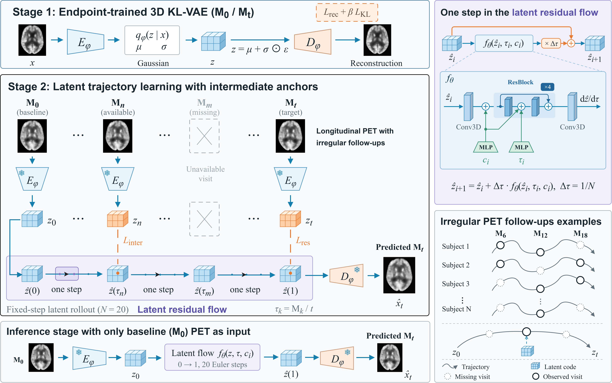

# LatentFlowNet

Code for **LatentFlowNet: Trajectory-Anchored Latent Flow for Longitudinal Brain PET Forecasting in Alzheimer's Disease Progression**.

LatentFlowNet forecasts a future brain PET volume from a baseline PET volume. A 3D KL-VAE learns the representation from endpoint scans; a time-conditioned residual flow learns the longitudinal trajectory using the available intermediate visits. Prediction uses the baseline PET and optional baseline covariates.



[Method figure (PDF)](assets/LatentFlowNet.pdf) · [Implementation details](docs/method.md)

## Installation

Use Python 3.10 or later. Install PyTorch for your CPU or CUDA environment, then install the remaining dependencies:

```bash
pip install -r requirements.txt
```

## Data

The scripts read preprocessed PET volumes in a common spatial grid, with shape **112 × 128 × 112**. Apply the study's PET-to-MRI registration, MNI resampling and intensity normalization before running the code. The loaders preserve the supplied intensities.

Organize your subject-level train, validation and test splits as follows. The identifiers below are placeholders.

```text
data/
  sample.nii.gz                  # reference image in the preprocessed grid
  train/
    subject_001/
      subject_001_ses-M00.nii.gz
      subject_001_ses-M06.nii.gz  # optional training anchor
      subject_001_ses-M12.nii.gz  # optional training anchor
      subject_001_ses-M18.nii.gz  # optional training anchor
      subject_001_ses-M24.nii.gz
  val/
    subject_002/
      subject_002_ses-M00.nii.gz
      subject_002_ses-M24.nii.gz
  test/
    subject_003/
      subject_003_ses-M00.nii.gz
      subject_003_ses-M24.nii.gz
```

Keep each subject in one split. Intermediate visits supply training supervision; validation and test use endpoints. Data and trained weights are supplied separately from this code repository.
<!--
## Stage 1: endpoint-trained KL-VAE

```bash
python train_vae.py --train \
  --data_root ./data --exp_dir ./result/klvae \
  --train_months 0 24 --val_months 0 24 \
  --latent_ch 4 --base_ch 32 --ch_mult 1 2 4 8 \
  --num_res_blocks 2 --kl_weight 1e-6 --gan_weight 0 \
  --epochs 1000 --batch_size 1 --lr 1e-4 --patience 100 \
  --gradient_checkpointing
```

The encoder downsamples twice, giving a latent volume of **4 × 28 × 32 × 28**. Encode the data using the trained posterior mean:

```bash
python train_vae.py --encode_all \
  --data_root ./data --output_dir ./data/latent_klvae \
  --checkpoint ./result/klvae/klvae_best.pth.tar
```

This preserves the split, subject folder and visit names. Latents are stored as NIfTI volumes with channels last; the training loader restores channel-first tensors.

## Stage 2: train LatentFlowNet

```bash
python train_latentflownet.py --mode train \
  --data_root ./data/latent_klvae \
  --vae_checkpoint ./result/klvae/klvae_best.pth.tar \
  --exp_dir ./result/latentflownet \
  --latent_ch 4 --hidden_ch 64 --time_dim 128 --num_blocks 4 \
  --n_steps 20 --baseline_time 0 --target_time 24 \
  --residual_weight 1.0 --recon_weight 0.5 \
  --inter_weight 2.0 --delta_mid_weight 0.5 \
  --lambda_c 0.05 --lambda_s 0.01 --lambda_m 0.2 \
  --epochs 500 --batch_size 2 --lr 1e-4 --patience 100 --seed 0
```

The VAE remains frozen. Available intermediate visits anchor the predicted trajectory; a missing visit contributes no observation or anchor loss. Set `--no_intermediates` for the endpoint-only setting.

For optional baseline covariates, add `--obs_file /path/to/baseline_covariates.csv`. The table contains `subject_id` followed by numeric baseline features in a fixed column order. Use the same feature definitions, training-derived transformations and column order for training, evaluation and prediction. The loader supplies a subject-level availability mask. The commands above use no diagnosis labels.

## Predict from baseline PET

```bash
python predict.py \
  --input /path/to/baseline_M00.nii.gz \
  --output /path/to/predicted_M24.nii.gz \
  --vae_checkpoint ./result/klvae/klvae_best.pth.tar \
  --checkpoint ./result/latentflownet/best.pth.tar
```

The input is a preprocessed baseline PET in the training grid. The prediction path is **posterior mean → 20 Euler steps → frozen decoder**. It requires no target or intermediate PET. The output retains the input spatial affine and header. For a model trained with covariates, also supply `--obs_file` and `--subject_id`.

## Evaluate a held-out split

```bash
python train_latentflownet.py --mode test \
  --data_root ./data/latent_klvae \
  --raw_data_root ./data/test \
  --vae_checkpoint ./result/klvae/klvae_best.pth.tar \
  --checkpoint ./result/latentflownet/best.pth.tar \
  --exp_dir ./result/latentflownet --n_steps 20
```

This reports image metrics against the supplied raw target volumes as well as decoded-target and latent metrics. `raw_data_root` is the test split directory containing subject folders. Use the same model architecture and baseline covariates as during training. Metric definitions and loss reductions are described in [the implementation notes](docs/method.md).
-->
## Code map

| File | Role |
| --- | --- |
| `model_vae.py` | 3D KL-VAE encoder and decoder |
| `train_vae.py` | Endpoint VAE training and posterior-mean encoding |
| `latentflownet.py` | LatentFlowNet field, Euler rollout and trajectory losses |
| `train_latentflownet.py` | LatentFlowNet training and held-out evaluation |
| `predict.py` | Baseline-only PET forecasting |
| `dataset_longitudinal.py` | Visit loading and sparse anchor batching |
| `config.py` | Device and reference-image defaults |

Run the small CPU checks with:

```bash
python -m unittest discover -s tests -v
```

These checks verify computation and interfaces using small tensors and generated test volumes. They do not retrain the study or reproduce its reported scores.

## License

MIT. The original copyright notice is retained in [LICENSE](LICENSE).
